

  <picture>
    <source media="(prefers-color-scheme: dark)" srcset="./assets/hero-dark.svg">
    <source media="(prefers-color-scheme: light)" srcset="./assets/hero-light.svg">
    
  </picture>
    
  
  
  
  

---

## ⚡ About & What I Build

I am **Padmanabhan S** (`@Sabareesh98421`), a **Software Engineer & QA at Buzl Digital Solutions** (previously Full-Stack Web Developer & Junior Infrastructure Admin at **Infocerv Solutions**) based in Bengaluru and Courtallam, Tamil Nadu.

- **Full-Stack Web & API Development:** Building web applications and backend services with **TypeScript, JavaScript, Angular, Next.js, Node.js, Express, and Bun + Elysia**, backed by **PostgreSQL (Prisma / Supabase), MongoDB, SQLite, and Redis**.
- **Performance & Production Impact:** Developed a real-time Angular & Node.js chat application supporting **100+ concurrent users**, optimized MongoDB queries to reduce retrieval time by **30%**, and built reusable Angular components that cut development time by **15%**.
- **Security-First QA & Infrastructure:** Trained in penetration testing and ethical hacking at **Red Team Hacker Academy (CICSA)**; experienced with **Playwright** E2E testing, **AWS** (`EC2`, `S3`, `VPC`, `IAM`, `AMI`), **Docker**, and **Grafana** monitoring (**99.9% uptime** across **50+** resolved production issues).

---

## 🚀 Selected Repositories & Projects

| Project | Stack | What It Does |
| :--- | :--- | :--- |
| **[STAR-Backend](https://github.com/Sabareesh98421/STAR-Backend)** | `Bun` · `Elysia` · `TypeScript` · `Prisma` · `PostgreSQL` · `Redis` · `Playwright` | Modular backend API featuring custom `TryCatch` async error-recovery pipelines, OTP email retry handling (`nodemailer`), WebSocket support, and Playwright E2E spec automation. |
| **[zamhelper](https://github.com/Sabareesh98421/zamhelper)** | `Next.js` · `TypeScript` · `Supabase` · `Firebase` · `Rust OCR` | Exam preparation platform that converts static PDF question papers (`pdf-parse` + Rust OCR) into interactive online practice sessions with Google OAuth ([Live App](https://zamhelper--zamhelper-240302.asia-southeast1.hosted.app)). |
| **[krishna-dahi-handi](https://github.com/Sabareesh98421/krishna-dahi-handi)** | `JavaScript (ES6)` · `HTML5 Canvas` · `CSS3` | Single-screen 2D browser arcade game inspired by the Janmashtami Dahi Handi tradition, built with custom pyramid-balance mechanics and WCAG AA keyboard accessibility. |
| **[Node-Graph-UI-practise](https://github.com/Sabareesh98421/Node-Graph-UI-practise)** | `JavaScript (ES6)` · `HTML5 Canvas / DOM` · `CSS3` | Interactive visual node-graph editor built from scratch (`canvas.js`, `nodes.js`, `nodeToNodeConnection.js`) to model draggable nodes and Bezier wire connections (`1 ★`). |
| **[teaStall (TeaSpot)](https://github.com/Sabareesh98421/teaStall)** | `Angular 18` · `Bun` · `Elysia` · `Docker Compose` | Full-stack order and inventory web application pairing an Angular 18 frontend (`Fe`) with a Bun + Elysia backend API (`Be`). |
| **[Courtallam-Cottage](https://github.com/Sabareesh98421/Courtallam-Cottage)** | `HTML5` · `CSS3` · `JavaScript` | Multi-page responsive cottage showcase and booking website designed for local tourism in Courtallam. |

---

## ♟️ Interactive Engineering & AppSec Showcase

*Instead of a standard contribution snake, here is a custom visual showcase built around my **TypeScript OOP Chess Board model** and **Cybersecurity / QA focus (`CICSA`)**.*

### 1️⃣ TypeScript OOP Chess Board & Tactical State Visualizer (`chessNodeJs`)

  <picture>
    <source media="(prefers-color-scheme: dark)" srcset="./assets/chess-engine-dark.svg">
    <source media="(prefers-color-scheme: light)" srcset="./assets/chess-engine-light.svg">
    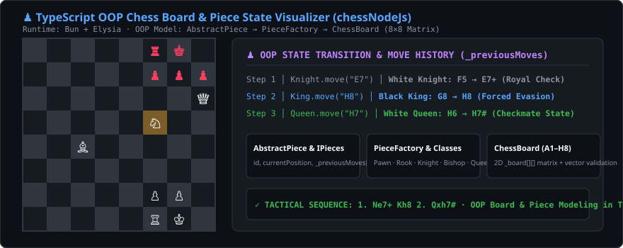
  </picture>

  
<b>♟️ View Tactical Sequence & OOP Design Breakdown (Click to Expand)</b>

   
  <ul>
    <li><b>Tactical Pattern Animated Above:</b> <code>1. Ne7+! Kh8 2. Qxh7#</code> — The White Knight jumps from <code>f5</code> to <code>e7</code> delivering a royal check, forcing the Black King to <code>h8</code>, followed by <code>Qxh7#</code> supported by the Knight.</li>
    <li><b>OOP Architecture (<code>chessNodeJs</code> on Bun + Elysia):</b> Uses an abstract <code>AbstractPiece</code> base class implementing <code>IPieces</code> (tracking <code>id</code>, <code>currentPosition</code>, and <code>_previousMoves[]</code>), specialized piece classes via <code>PieceFactory</code>, and an 8×8 2D <code>ChessBoard</code> coordinate matrix (<code>A1–H8</code>).</li>
  </ul>

### 2️⃣ AppSec Radar Sweep — 53×7 Contribution Matrix (`CICSA Edition`)

  <picture>
    <source media="(prefers-color-scheme: dark)" srcset="./assets/cyber-grid-dark.svg">
    <source media="(prefers-color-scheme: light)" srcset="./assets/cyber-grid-light.svg">
    
  </picture>

  
<b>👾 Bonus Arcade: Click to Expand Classic Pac-Man Contribution Graph</b>

   
  

    <picture>
      <source media="(prefers-color-scheme: dark)" srcset="./assets/pacman-contribution-graph-dark.svg">
      <source media="(prefers-color-scheme: light)" srcset="./assets/pacman-contribution-graph.svg">
      
    </picture>
  

---

## 🛠️ Tech Stack & Tools

<table>
  <tr>
    <td align="center" width="25%"><b>Frontend & Design</b></td>
    <td align="center" width="25%"><b>Backend & Runtime</b></td>
    <td align="center" width="25%"><b>Databases & Cloud</b></td>
    <td align="center" width="25%"><b>Security, QA & DevOps</b></td>
  </tr>
  <tr>
    <td align="center">
      
    </td>
    <td align="center">
      
    </td>
    <td align="center">
      
    </td>
    <td align="center">
      
    </td>
  </tr>
  <tr>
    <td align="center">TypeScript · JavaScript · Angular · Next.js · React · Tailwind CSS · SCSS · Figma</td>
    <td align="center">Bun.js · Elysia · Node.js · Express · Prisma ORM · REST APIs & WebSockets</td>
    <td align="center">PostgreSQL · MongoDB · SQLite · Redis · Supabase · AWS (EC2, S3, VPC, IAM)</td>
    <td align="center">Playwright QA · Kali Linux · Security Testing (CICSA) · Docker · Grafana</td>
  </tr>
</table>

---

## 📊 GitHub Contribution & Activity Analytics

### 📈 Contribution Overview & Weekly Velocity

  <picture>
    <source media="(prefers-color-scheme: dark)" srcset="./assets/summary-profile-details.svg">
    <source media="(prefers-color-scheme: light)" srcset="./assets/summary-profile-details-light.svg">
    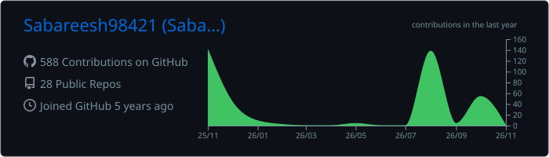
  </picture>

  <picture>
    <source media="(prefers-color-scheme: dark)" srcset="./assets/activity-graph-dark.svg">
    <source media="(prefers-color-scheme: light)" srcset="./assets/activity-graph-light.svg">
    
  </picture>

### 🔥 Streak, Repository Metrics & Language Breakdown

  <picture>
    <source media="(prefers-color-scheme: dark)" srcset="./assets/streak-dark.svg">
    <source media="(prefers-color-scheme: light)" srcset="./assets/streak-light.svg">
    
  </picture>
  &nbsp;
  <picture>
    <source media="(prefers-color-scheme: dark)" srcset="./assets/summary-stats.svg">
    <source media="(prefers-color-scheme: light)" srcset="./assets/summary-stats-light.svg">
    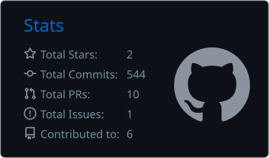
  </picture>

  <picture>
    <source media="(prefers-color-scheme: dark)" srcset="./assets/summary-repos-per-language.svg">
    <source media="(prefers-color-scheme: light)" srcset="./assets/summary-repos-per-language-light.svg">
    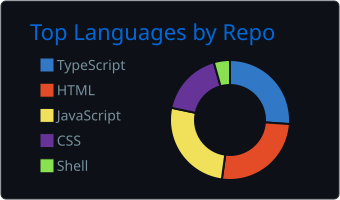
  </picture>
  &nbsp;
  <picture>
    <source media="(prefers-color-scheme: dark)" srcset="./assets/summary-most-commit-language.svg">
    <source media="(prefers-color-scheme: light)" srcset="./assets/summary-most-commit-language-light.svg">
    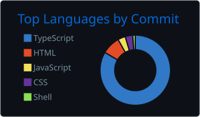
  </picture>
  &nbsp;
  <picture>
    <source media="(prefers-color-scheme: dark)" srcset="./assets/summary-productive-time.svg">
    <source media="(prefers-color-scheme: light)" srcset="./assets/summary-productive-time-light.svg">
    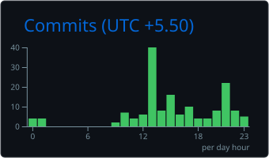
  </picture>

---

## 🧭 Full-Stack & Security-Aware QA Workflow

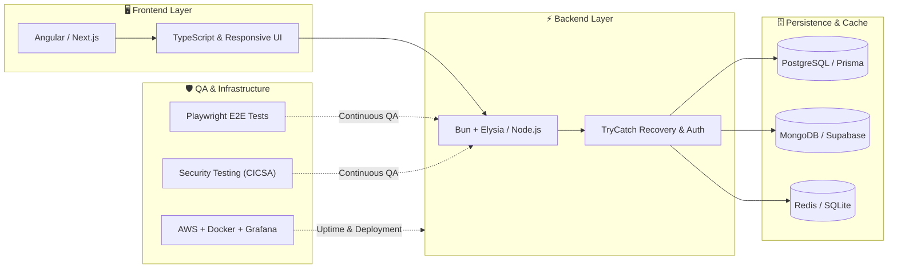

---

## 🤝 Let's Connect

I am open to **Full-Stack / Backend development opportunities, QA & security testing collaborations, and project discussions**.

- 💼 **LinkedIn:** [linkedin.com/in/padmanabhan-s-24march2002](https://www.linkedin.com/in/padmanabhan-s-24march2002)
- 📧 **Email:** [padmanabhansubramanian28@gmail.com](mailto:padmanabhansubramanian28@gmail.com)
- 📍 **Location:** Bengaluru, Karnataka & Courtallam / Tenkasi, Tamil Nadu, India

> *"Where the question arises, from the same source the answer also comes." — Maharishi Ramar*
